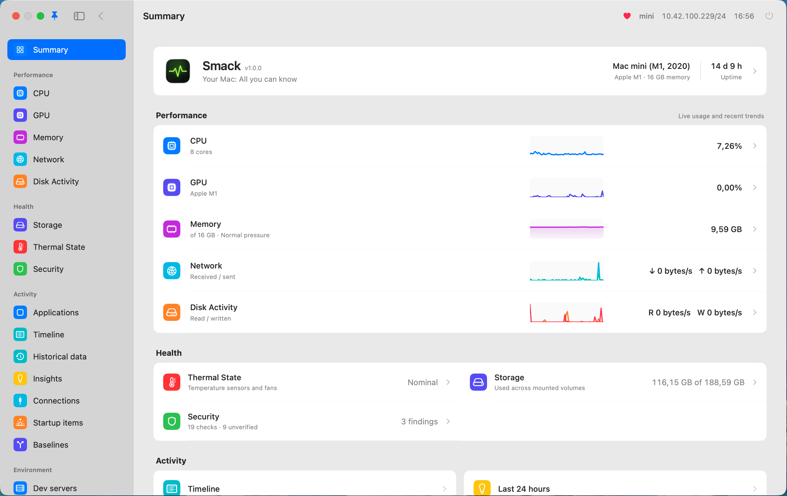

# Smack

### **What a Pro user wants to know about a Mac.**

Smack lives in the notch and menu bar. Move the pointer up to see what your Mac is doing, who is doing it, and act on it. No third-party dependencies, no data leaving the machine.

[](https://lab42.it/assets/images/smack/Smack-1.0.0-Brochure.pdf)

## Features

- **Onboarding:** a first-launch window to pick the menu-bar Panel or a Standard Window, Project folders and a Performance preset.
- **Work:** Projects, Dev servers, Docker and AI agents grouped in a dedicated sidebar category, with matching violet icon shades across pages and Summary.
- **Summary at a glance:** live tiles for every area (per-core load, memory composition, traffic and disk charts, busiest apps, running agent sessions, containers, updates), with what needs attention at the top.
- **Live dashboard:** CPU, GPU, memory, network, disk, battery and thermal, with live, 1h, 24h and 7d charts.
- **Applications and processes:** sortable lists with open files, connections, threads, libraries, signature, ancestry and logs.
- **Profiling:** `footprint`, `vmmap`, `heap`, `leaks` and `sample` results summarized per application.
- **Network:** per-process traffic, listening ports and every TCP connection grouped by application.
- **Dev servers:** local listeners grouped by project, with git branch, Docker Compose context and every HTTP(S) endpoint linked on an expandable Summary tile.
- **AI agents:** live coding-agent sessions with Working/Idle state, live CPU, memory, disk and network charts, nested sessions, MCP servers, helpers, listeners and recent commands, plus their configuration in a separate Configs view.
- **Session Timeline:** every prompt, answer, command, MCP and tool call of a Claude Code, Codex or OpenCode session on zoomable lanes, live or replayed from History, with each event's full text, output or diff a click away.
- **Projects:** Git repositories discovered under your Project folders, with a Summary tile of recent projects and clickable ports, a folder-filtered table with visible sort buttons (latest activity first by default), sortable by name, latest activity, running session start time, size, language, branch, status or location, and a detail page with a file browser and text viewer, local commit history and patches, branches, tags, remotes, deep git status, clickable listening ports, related dev servers, Docker Compose containers, AI agent sessions and the runtimes each repository pins or carries (virtualenvs, `.tool-versions`, `.nvmrc`, `mise.toml`); Summary rows show ports, running agent sessions, container counts and runtimes per project.
- **Docker:** containers, images, volumes and networks, with start, stop and restart.
- **Homebrew:** browse, install, update, uninstall, services and cleanup.
- **Startup items:** login items, launch agents, daemons and cron jobs, each with an on/off switch.
- **Security:** offline checks for SIP, encryption, exposure, MDM, privacy grants and persistence changes.
- **Timeline:** a record of process starts, new listeners, startup changes, mounts, sleep, power and network events.
- **History and Insights:** stored system and per-program history, zoomable charts, and top disk writers and new destinations.
- **Baselines:** snapshot a Mac and see what has changed since, or compare it with another Mac ([format](docs/baseline-format.md)).
- **Alerts:** local notifications for thresholds and events (CPU, memory, disk, battery, new listeners, persistence).
- **Storage explorer:** a disk usage map of your home folder or the whole disk.
- **Installed apps:** app sizes and uninstall to the Trash.
- **Dev environments:** 26 languages and runtimes with versions, paths and packages.
- **Menu-bar icons:** every menu-bar icon in the panel, including those hidden by the notch.
- **Standard window (optional):** run Smack as an ordinary app with a Dock icon, minimize and full screen.
- **Quick lookups:** check IP addresses and file hashes on IPinfo, AbuseIPDB, VirusTotal, Shodan and others.
- **Automation:** `smack://` URLs, a `smack` CLI with JSON/CSV output, and Shortcuts actions. See the [CLI](docs/cli.md) and [URL scheme](docs/url-scheme.md).
- **Superuser sampling (optional):** a signed helper that also shows other users' processes and files.

Lookups send only an address or hash, and only when you click.

## Requirements

macOS 15 or later on Apple silicon.

## Install

```bash
brew install alvagante/tap/smack
```

Or download `Smack-<version>-macOS-arm64.dmg` from [Releases](../../releases), open it and drag Smack to Applications. Releases are signed and notarized.

Open the panel by hovering over or clicking the notch, or by clicking the menu-bar icon. Quit with ⌘Q. To use Smack as a regular resizable window with a Dock icon, set Settings > General > Window style to Standard Window.

## Update

```bash
brew upgrade --cask smack
```

Or replace `/Applications/Smack.app` with the new release.

**From 0.7.0 or earlier:** 1.0.0 has a new signature, so reset the old permission grants once:

```bash
pkill -x Smack
tccutil reset All it.lab42.smack
open /Applications/Smack.app
```

Grant Screen Recording and Accessibility again when asked. If you used superuser sampling, turn **Sample processes owned by other users** off and on in Settings. Then approve Smack in System Settings > General > Login Items & Extensions.

## Uninstall

Turn off superuser sampling in Settings, then delete `Smack.app` (`brew uninstall --cask smack`). If you deleted the app while the helper was installed:

```bash
sudo launchctl bootout system/it.lab42.smack.helper
sudo rm -f /Library/LaunchDaemons/it.lab42.smack.helper.plist /Library/PrivilegedHelperTools/it.lab42.smack.helper
```

## Build from source

Requires full Xcode 16 or later (Command Line Tools alone are not enough).

```bash
Scripts/build-app.sh
open dist/Smack.app
```

Without a signing certificate the app is ad-hoc signed. It runs, but superuser sampling is unavailable and you must grant permissions again after each rebuild. To avoid both, create a `Smack Local Dev` certificate as described in [docs/development/signing.md](docs/development/signing.md). Specs, design notes and release procedures are in [docs/development](docs/development).

## License

[MIT](LICENSE)
