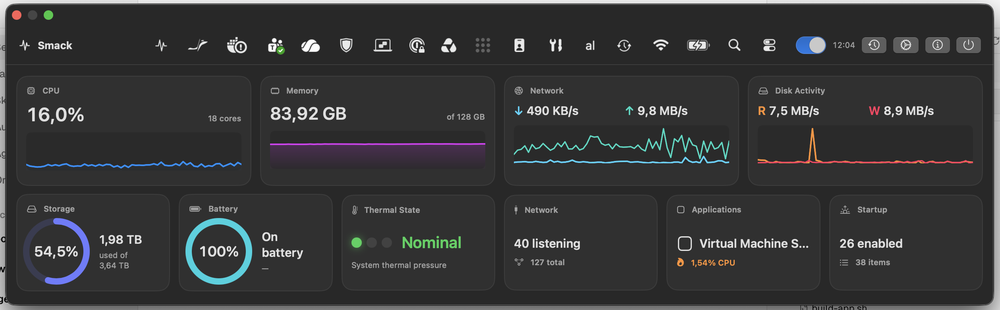

# Smack

Smack is a lightweight macOS system monitor that opens from the camera island or menu bar. It presents live metrics in a compact, visual dashboard without third-party dependencies.



## Features

- **Camera-island dashboard:** hover or click the notch (or use the menu-bar icon) for live CPU, memory, network, and disk activity graphs, storage and battery gauges, and thermal state.
- **Native menu-bar icons in the panel:** see every menu-bar icon, including those hidden behind the notch, and click them from Smack (opt-in).
- **Network Ports:** listening TCP ports with the owning process, browser links, and active client connections.
- **One-click investigation:** look up public remote addresses on IPinfo, Hurricane Electric BGP, AbuseIPDB, VirusTotal, GreyNoise, and Shodan; reveal, search, or check open files and libraries on VirusTotal by SHA-256.
- **Applications and processes:** sortable metrics with real app icons, and process details with open files, connections, threads, and loaded libraries.
- **Advanced system details:** Mac hardware and software information.
- **History:** persistent, searchable history with JSON/CSV export, configurable background collection, and launch at login.

All data stays on your Mac: lookups send only an address, file name, or hash, and only when you click. Some other-user or protected processes remain unavailable because Smack runs without a privileged helper.

## Requirements

- macOS 15 or later
- Apple-silicon Mac
- Swift 6 toolchain for development
- Optional: Screen Recording and Accessibility permissions for native menu-bar icons

## Install from a GitHub release

Release builds are not notarized by Apple, so macOS blocks the first launch.

1. Download `Smack-<version>-macOS-arm64.zip` from the GitHub release, optionally check it against the `.sha256` file (`shasum -a 256 -c Smack-<version>-macOS-arm64.zip.sha256`), unzip it, and move `Smack.app` to `/Applications`.
2. Try to open the app normally. macOS blocks it and shows a warning that it cannot be opened.
3. Click **OK** to close the warning.
4. Go to **Apple menu > System Settings > Privacy & Security**.
5. Scroll down to the **Security** section. You will see a message saying Smack was blocked.
6. Click **Open Anyway** and enter your Mac's administrator password.
7. Click **Open** on the final confirmation prompt.

The **Open Anyway** button is only available for about one hour after your first attempt to open the app. Control-click > Open no longer bypasses this check on macOS 15 and later.

Alternatively, from Terminal, remove the quarantine flag and open the app:

```bash
xattr -dr com.apple.quarantine /Applications/Smack.app
open /Applications/Smack.app
```

Only do this for a download you trust and have verified against its checksum.

If you enable native menu-bar icons, grant Screen Recording and Accessibility when asked, then reopen Smack. Release builds are not signed with a stable identity yet, so each update may ask for these permissions again; see [docs/signing.md](docs/signing.md).

## Build and run

```bash
Scripts/build-app.sh
open dist/Smack.app
```

Create a `Smack Local Dev` code-signing certificate (or set `SMACK_SIGN_IDENTITY`) to keep Screen Recording and Accessibility grants across rebuilds; see [docs/signing.md](docs/signing.md) for local and release signing.

Hover over or click the camera island to open the panel, depending on Settings. The menu-bar icon works on every display. Closing the panel only hides it; use **Settings → Quit Smack** to exit completely.

## Test

```bash
swift test
```

Pull requests run the test and build workflow. Pushing a Git tag builds `Smack-<tag>-macOS-arm64.zip` and publishes it with a SHA-256 checksum to the GitHub release.

## License

Smack is released under the [MIT License](LICENSE).
